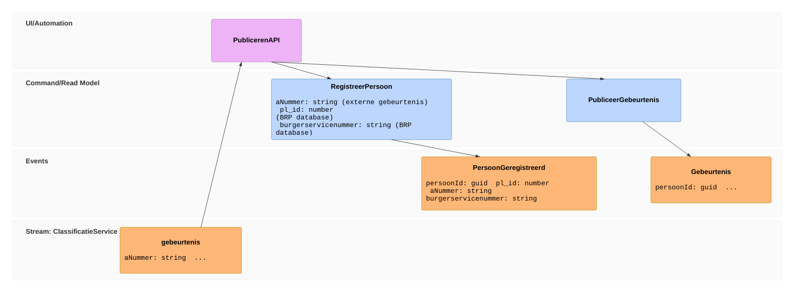
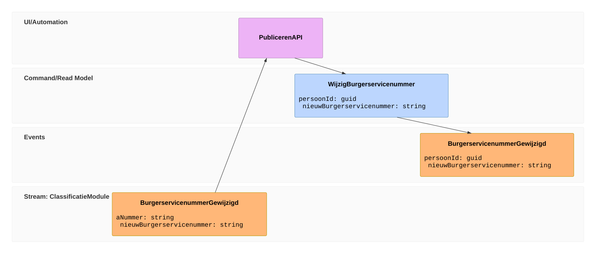
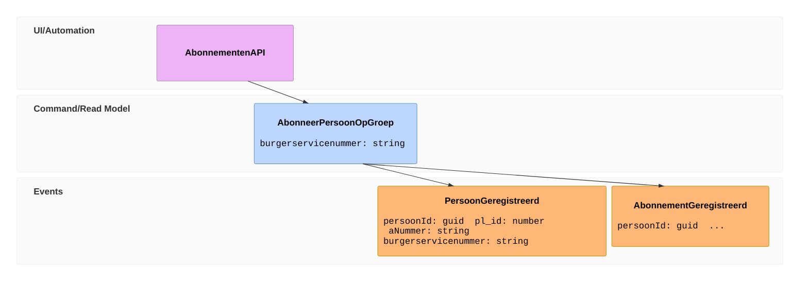

# ADR 007: Gebruik (interne) persoonsidentificatie voor personen in gebeurtenissen in BRP API Gebeurtenissen

## Status
Geaccepteerd

## Context

Op dit moment worden gebeurtenissen van een persoon gepubliceerd met het a-nummer van de persoon om te kunnen bepalen om welke persoon het gaat. Echter afnemers abonneren zich op gebeurtenissen van personen met het burgerservicenummer van de persoon. Dit is ook het geval als een afnemer gebeurtenissen opvraagt.

Initieel is er ook de wens om de Gebeurtenissen Publiceren API aan te passen (en hiermee ook de Classificatie Service) zodat gebeurtenissen van een persoon worden gepubliceerd met zowel het a-nummer als het burgerservicenummer van de persoon. De reden hiervoor is dat het BRP API Gebeurtenissen geen bevragingen hoeft te doen om het burgerservicenummer op te halen als een gebeurtenis wordt gepubliceerd door de Classificatie Service.

Hoewel zowel het a-nummer als het burgerservicenummer kunnen worden gebruikt om een persoon te identificeren, zijn zij niet betrouwbaar. Het kan namelijk voorkomen dat twee personen hetzelfde burgerservicenummer hebben of dat twee personen met verschillend a-nummer dezelfde persoon zijn. Om deze fouten op te lossen kunnen zowel het burgerservicenummer als het a-nummer worden gewijzigd. Hierdoor is het niet mogelijk om op basis van het a-nummer of burgerservicenummer te bepalen bij welke persoon een gebeurtenis hoort.

Ook kan de pl_id (de technische sleutel voor een persoon in de BRP) niet worden gebruikt om een persoon uniek te identificeren, omdat deze ook kan wijzigen (aanname).

## Beslissing

Omdat BRP API Gebeurtenissen gebruik maakt van een native Event Store waar het niet mogelijk is om opgeslagen gebeurtenissen te wijzigen, moet het a-nummer en het burgerservicenummer niet als persoonsidentificatie worden gebruikt in de opgeslagen gebeurtenissen. In plaats daarvan genereert BRP API Gebeurtenissen een eigen unieke identificatie (GUID) en gebruikt deze om personen te koppelen aan gebeurtenissen.
Deze identificatie (persoonId) wordt gegenereerd op het moment dat de eerste gebeurtenis voor een persoon wordt gepubliceerd en wordt samen met het a-nummer, het burgerservicenummer en de pl_id van de persoon vastgelegd in een **persoon geregistreerd** gebeurtenis.
De te publiceren gebeurtenis wordt vervolgens vertaald naar een interne gebeurtenis waarin persoonId wordt gebruikt als identificatie in plaats van het a-nummer, burgerservicenummer, of pl_id.



Zie [persoon-geregistreerd-publiceren.feature]() voor de uitwerking van de specificatie.

Deze persoonId verandert nooit, ongeacht of het a-nummer of het burgerservicenummer van de persoon wijzigt.



```gherkin
Abstract Scenario: Het <identificatienummer> van een geregistreerde persoon wijzigt
    Gegeven er is een 'persoon geregistreerd' gebeurtenis gepubliceerd voor 'Jan'
    Als het <identificatienummer> van 'Jan' wijzigt
    Dan is een '<gebeurtenis>' gebeurtenis voor 'Jan' gepubliceerd
    En is de persoonId in de gepubliceerde gebeurtenis gelijk aan de persoonId in de 'persoon geregistreerd' gebeurtenis gepubliceerd voor 'Jan'

    Voorbeelden:
    | identificatienummer | gebeurtenis                   |
    | a-nummer            | a-nummer gewijzigd            |
    | burgerservicenummer | burgerservicenummer gewijzigd |
```

Het publiceren van een persoon geregistreerd gebeurtenis voor een persoon moet ook gebeuren wanneer een abonnee van een afnemer zich abonneert op gebeurtenissen van een persoon en er zijn voor de betreffende persoon nog geen gebeurtenissen gepubliceerd in BRP API Gebeurtenissen.



Zie [persoon-geregistreerd-publiceren-bij-abonneren.feature]() voor uitwerking van de specificatie.

Deze oplossing heeft een aantal voordelen:
1. Het minimaliseert de hoeveelheid gevoelige informatie die in interne gebeurtenissen wordt opgeslagen.
2. Gevoelige informatie wordt alleen opgenomen in de gebeurtenissen waar het relevant is. Het a-nummer van een persoon is bijvoorbeeld niet relevant voor een verhuisd gebeurtenis.
3. Het correleren van gebeurtenissen voor een persoon is eenvoudiger omdat dit kan gebeuren op basis van een sleutel die niet wijzigt.
5. De mapping tussen de interne persoonId en de BRP identificatienummers (a-nummer, burgerservicenummer en/of pl_id) wordt alleen vastgelegd in de PersoonGeregistreerd, AnummerGewijzigd en BurgerservicenummerGewijzigd gebeurtenissen. Deze kunnen tijdens het vertalen van externe naar interne gebeurtenissen worden ge-queried om de persoonId te achterhalen.

Wat buiten de scope van deze oplossing valt is het oplossen van een [dubbelinschrijving](https://www.rvig.nl/hup/dubbelinschrijving) (twee persoonslijsten in de BRP database behoren tot dezelfde persoon). Het oplossen van een dubbelinschrijving is voor een groot deel een handmatige procedure en het resultaat hiervan kan alleen via de ClassificatieModule als gebeurtenissen worden gepubliceerd.
